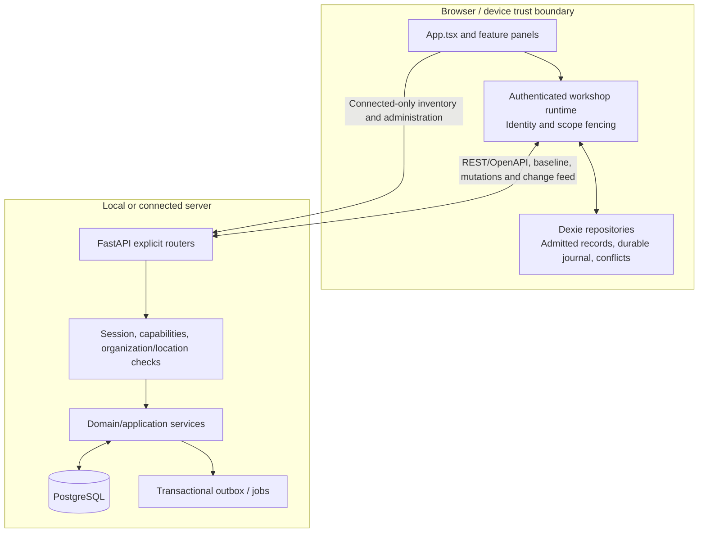
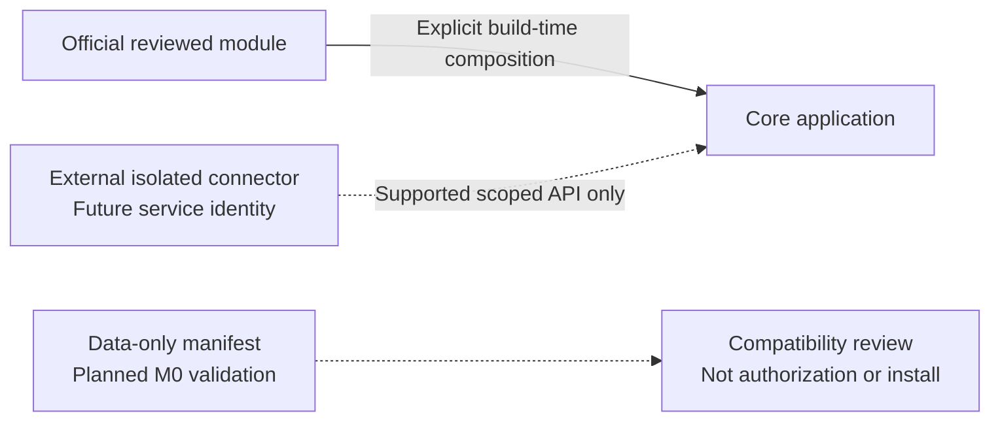

# Architecture

OCWP is a **modular monolith** with a React/TypeScript PWA, explicit offline
boundaries and a PostgreSQL-backed Python API. This map describes current source,
not an implemented plugin loader or every future roadmap component.

## Source map

| Boundary                  | Source                                                                        | Invariant                                                                                                        |
| ------------------------- | ----------------------------------------------------------------------------- | ---------------------------------------------------------------------------------------------------------------- |
| Application composition   | `apps/web/src/App.tsx`                                                        | Explicit reviewed panels; no arbitrary remote JavaScript.                                                        |
| Local ownership/admission | `apps/web/src/access-kernel/`                                                 | Principal, organization, location, epoch/incarnation and recovery matter.                                        |
| Sync                      | `apps/web/src/sync/`                                                          | Durable mutation intent, idempotency, incremental changes and explicit conflicts; not wall-clock ordering alone. |
| Public wire contracts     | `packages/api-client/openapi.json`, `packages/api-client/src/`                | Generated contracts and mounted routes, not private domain functions.                                            |
| API composition           | `services/platform/src/cycling_workshop/app.py`                               | Explicit router registration; quote router is not mounted.                                                       |
| Authorization             | `services/platform/src/cycling_workshop/identity/`                            | Server-enforced capability/scoped RBAC, deny by default; legacy wildcard grants remain frozen.                   |
| Persistence               | `services/platform/src/cycling_workshop/db/`, `services/platform/migrations/` | Reviewed SQLAlchemy models and Alembic lineage; no external connector SQL credentials.                           |
| Events                    | `services/platform/src/cycling_workshop/events/outbox.py`                     | Transactional internal events, not an implemented public delivery API.                                           |
| Packaging                 | `infra/compose/`, `scripts/operations/`                                       | Compose baseline, secret boundaries, backup and demonstrated restore.                                            |
| Public presentation       | `docs/site/`, `scripts/docs/`                                                 | Inert allowlisted documentation; no workshop application/data deployment.                                        |

## Offline is a domain contract, not a blanket promise

Local operational workflows preserve admitted records and pending intent across
supported offline/reload scenarios. Connected administration and inventory reads
have different availability and authority requirements. A new module cannot
join sync by declaring `offline: true`: it needs its own schema, conflict,
identity, migration and recovery qualification. Server backups do not include
every browser's local journal. Never discard local data as a repair shortcut.

## Extension strategy

Solid official composition exists as source imports. Dashed connector/manifest
paths are **planned contracts**, not a runtime SDK. Official modules are trusted
reviewed code; they are not sandboxed from Core. External integrations must stay
in separate processes, use supported scoped APIs and never receive arbitrary
in-process execution or Core database access. See the
[staged module strategy](docs/08-open-source/2026-10-27-compatible-modules.md).

## Normative references

- [Foundation and accepted ADR baseline](docs/00-foundation/open-cycling-workshop-platform-foundation-v0.2.md)
- [Technical architecture](docs/02-technical-architecture/open-cycling-workshop-platform-phase-2-technical-architecture-v0.2.md)
- [Engineering architecture](docs/05-engineering/open-cycling-workshop-platform-phase-5-repository-engineering-architecture-v0.1.md)
- [Governance and plugin ecosystem](docs/08-open-source/open-cycling-workshop-platform-phase-8-open-source-governance-plugin-ecosystem-v0.1.md)
- [Current evidence/gates](docs/10-spec-development/execution-state.yaml)

Core remains AGPL-3.0-only and vendor-neutral; no mandatory WhatsApp, payment,
AI or proprietary cloud service is introduced by this architecture.
