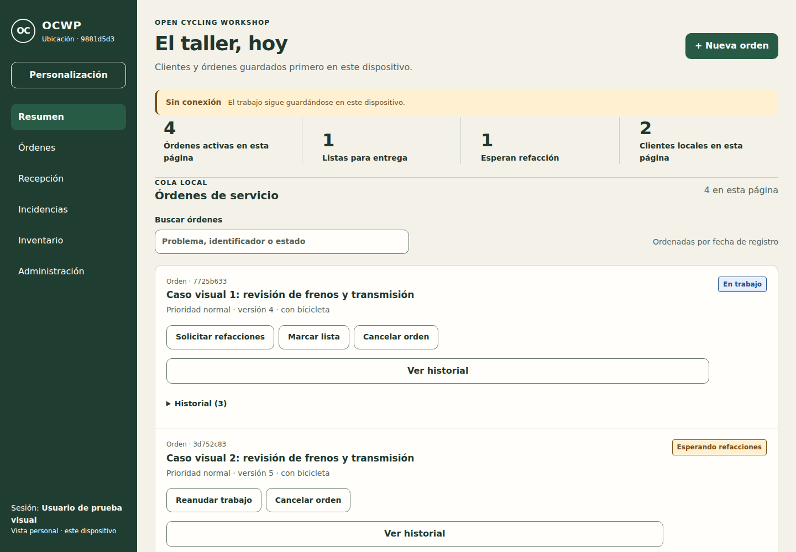
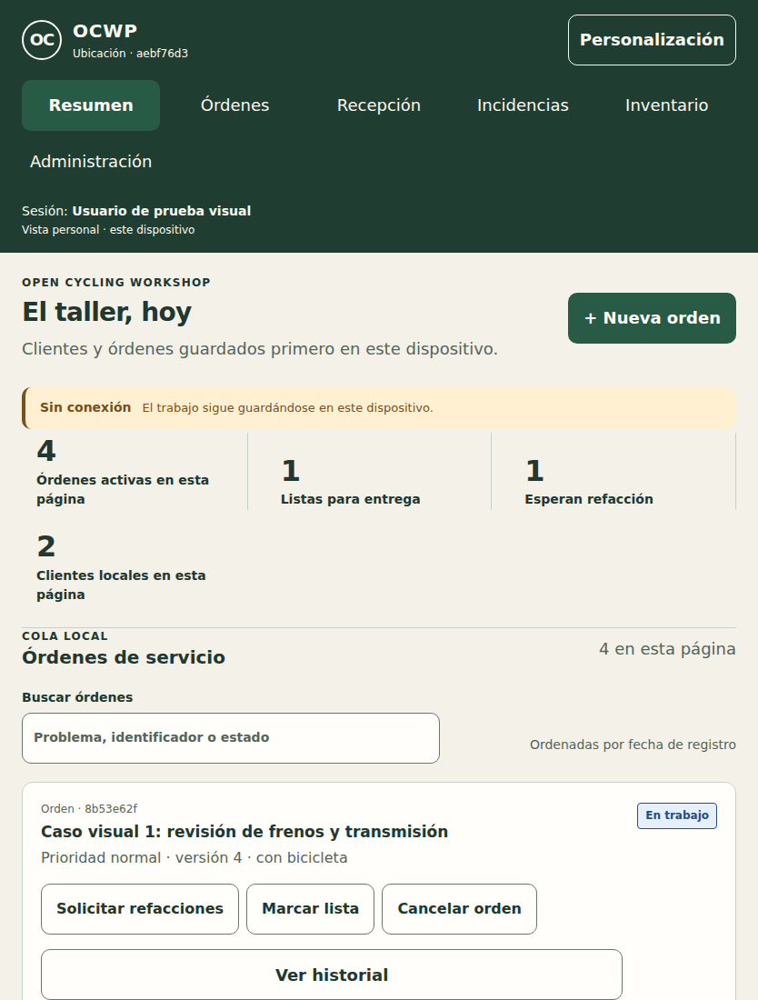
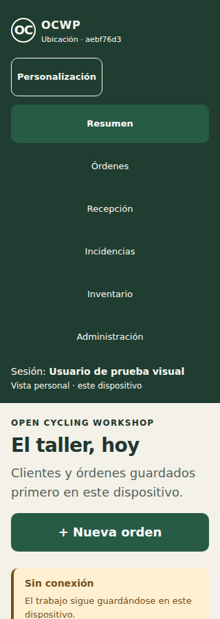
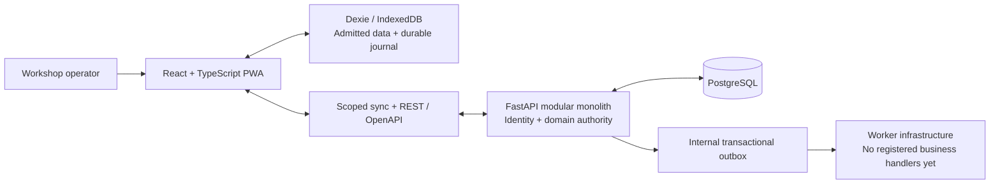

# Open Cycling Workshop Platform

### Your workshop. Your data. Your way forward.

An open-source, **local-first and offline-first** operating platform for bicycle
workshops, stores, cooperatives and service organizations. Built around a modular
monolith, explicit permissions and vendor-neutral infrastructure.

[Explore the product](#see-the-real-application) · [Get started](#get-started) ·
[Architecture](ARCHITECTURE.md) · [Contribute](CONTRIBUTING.md) ·
[Module strategy](docs/08-open-source/2026-10-27-compatible-modules.md)

> **Development candidate — not a production release.** Automated source-bound
> qualification exists; physical Windows/Android acceptance, manual reviews and
> real installation gates remain open. GitHub Pages presentation sources are
> prepared in [`docs/site`](docs/site); publication is separately gated. There is
> no live workshop deployment implied by this repository or its screenshots.

## See the real application



**Real production-PWA build, synthetic test data — not a mockup.** Captured in
Chromium on **2026-10-27**, source
[`a960bdd`](https://github.com/IzignaMx/open-cycling-workshop/tree/a960bddb94189c6c74c7f3d0a72472636c3caced),
[CI run 40571345621](https://github.com/IzignaMx/open-cycling-workshop/actions/runs/40571345621).
These captures match the application source at this documentation increment;
later runtime changes must refresh or label them historical. They do not prove
physical-device acceptance or production readiness. Original PNGs, dimensions,
fixture/test identity and SHA-256 are recorded in the
[capture manifest](docs/site/screenshots.json).

| Tablet viewport                                                                                             | Narrow 320px viewport                                                                                    |
| ----------------------------------------------------------------------------------------------------------- | -------------------------------------------------------------------------------------------------------- |
|  |  |

[View the complete Turno nocturno capture](docs/site/assets/screenshots/noche-canonical-desktop-full.png).
Four visual themes share the same operational rules. Browser viewport evidence
is not a physical tablet or phone qualification.

## What is available — and what is not

| Area       | Current implemented source                                                                    | Important boundary                                                                                                    |
| ---------- | --------------------------------------------------------------------------------------------- | --------------------------------------------------------------------------------------------------------------------- |
| Workshop   | Customers, bicycles, service orders, local journal, sync and conflict handling                | Offline admission depends on identity/context and previously admitted data; do not assume every screen works offline. |
| Identity   | Connected account, users, permissions, locations and session administration                   | Server-enforced scoped capabilities; no implicit grants to new features.                                              |
| Inventory  | Products/ledger domain and scoped connected read UI                                           | Inventory reads are online-only, not a local stock snapshot or inventory command UI.                                  |
| Appearance | Four themes, personal preferences, local logo and shared workshop branding                    | Personal device presentation differs from shared workshop identity.                                                   |
| Quotes     | Arithmetic/history, persistence/service prerequisites, authority fences and namespace privacy | No mounted quote API or quote UI; streaming/cancellation/capacity and activation gates remain open.                   |
| Operations | Compose candidate, diagnostics, backup/restore and source-bound hosted runtime evidence       | Not proof of a real installation, physical ARM device or production release.                                          |
| Extensions | Explicit source composition and API boundaries; staged compatibility strategy                 | `packages/plugin-sdk` remains a placeholder, not an installable plugin runtime.                                       |

The implemented identity/security baseline includes:

- persistent users, Argon2 password hashing, signed/revocable sessions, real login endpoints and capability-based RBAC with deny-by-default behavior

The [execution state](docs/10-spec-development/execution-state.yaml),
[changelog](CHANGELOG.md) and [manual gates](MANUAL-ACTIONS-CHECKLIST.md) are the
scope/evidence references. A green unit test does not prove PostgreSQL, a PWA
build does not prove offline operation, and a backup is incomplete without restore.

## Get started

### 1. Understand the project

- **Workshop operators:** start with the capability table and real captures above.
  Identify your device, local connectivity and required offline workflows.
- **Implementers:** read the [local runtime guide](docs/07-operations/2026-10-14-local-runtime.md)
  and [backup/restore procedure](docs/07-operations/2026-10-14-backup-restore.md).
  Installation is an explicitly reviewed operation, not a README one-liner.
- **Developers/designers:** read [CONTRIBUTING](CONTRIBUTING.md), the
  [architecture map](ARCHITECTURE.md) and [AGENTS](AGENTS.md).
- **Extension authors:** read the [compatibility strategy](docs/08-open-source/2026-10-27-compatible-modules.md)
  before assuming there is a published SDK or service-identity API.

### 2. Prepare a development checkout

Use Node **22.16.0** (the hosted reference), Python **3.13.x**, pnpm **11.17.0** and
uv. Check [`.nvmrc`](.nvmrc), [`.python-version`](.python-version),
[`package.json`](package.json) and [`pyproject.toml`](pyproject.toml) before setup.
No production credentials are needed for source/static checks.

```sh
git clone https://github.com/IzignaMx/open-cycling-workshop.git
cd open-cycling-workshop
corepack enable
corepack prepare pnpm@11.17.0 --activate
pnpm install --frozen-lockfile
uv sync --all-packages --group dev --locked
```

### 3. Verify the source before running an installation

```sh
pnpm contracts:check
pnpm typecheck
pnpm --filter @ocwp/web test
pnpm --filter @ocwp/web build
uv run python scripts/ci/verify_v01.py --allow-blocked
```

Inspect the verifier's failures and environment blockers rather than treating
`--allow-blocked` as release acceptance. Full tests use `pnpm test`. With the activated Python environment, the direct
backend command is `PYTHONPATH=.:services/platform/src pytest -q`. PostgreSQL,
Docker and browser checks need their real runtimes. The production-PWA E2E suite
requires a **dedicated disposable `_test` or `_e2e` database**; its setup is
intentionally destructive and must never target workshop data.

For interactive development, `pnpm dev` starts Vite only; it is not a complete
server/bootstrap procedure. Follow the [operations guide](docs/07-operations/2026-10-14-local-runtime.md)
for server topology, secrets, migrations and explicitly authorized account setup.
Keep secrets outside Git and preserve each browser's local journal separately
from server backups. Never clear IndexedDB to fix an upgrade.

### 4. Preview the public documentation

This serves only static documentation, not the operational application:

```sh
python3 scripts/docs/build_public_site.py --output artifacts/public-preview
python3 -m http.server 8088 --bind 127.0.0.1 --directory artifacts/public-preview
```

Use a new/empty output directory each time. The builder rejects private/unexpected
files and verifies screenshot hashes; `--require-current` additionally requires
the runtime source to match its captures. Open `http://127.0.0.1:8088` locally.
The read-only **Public presentation preview** workflow builds and checks repository
subpath behavior, keyboard/reflow and axe, retaining artifacts. It does not enable
or deploy Pages. See the [publication plan](docs/superpowers/plans/2026-10-27-public-project-presentation.md).

## How it fits together



Inventory reads and connected administration are not implicitly part of the
local journal. Public connector delivery is not provided by the internal outbox.
See [ARCHITECTURE.md](ARCHITECTURE.md) for source paths, trust boundaries and
extension stages.

## Collaborate and report bugs

1. Connect a proposal to a real workshop need and the normative specification.
2. Keep a small branch/PR, add failing-then-passing tests and update evidence.
3. Sign commits with `git commit -s` (DCO 1.1); preserve license and security rules.
4. Follow review and exact-source CI; never weaken tests to obtain a green badge.

For a non-sensitive [bug report](https://github.com/IzignaMx/open-cycling-workshop/issues/new),
include source SHA, environment/device, minimal synthetic reproduction, expected
versus observed behavior and redacted evidence. Do not upload customer data,
tokens or private logs. Suspected vulnerabilities must follow
[SECURITY.md](SECURITY.md): private advisories when available, otherwise private
maintainer contact — not a public issue.

## License and independence

Core and official apps: **GNU AGPL v3 only (`AGPL-3.0-only`)**. See [LICENSE](LICENSE).
Preserve applicable corresponding-source obligations, including for modified
network-interactive versions. Core has no mandatory proprietary SaaS dependency.

[Foundation](docs/00-foundation/open-cycling-workshop-platform-foundation-v0.2.md) ·
[Governance](GOVERNANCE.md) · [Code of conduct](CODE_OF_CONDUCT.md) ·
[Maintainers](MAINTAINERS.md)
